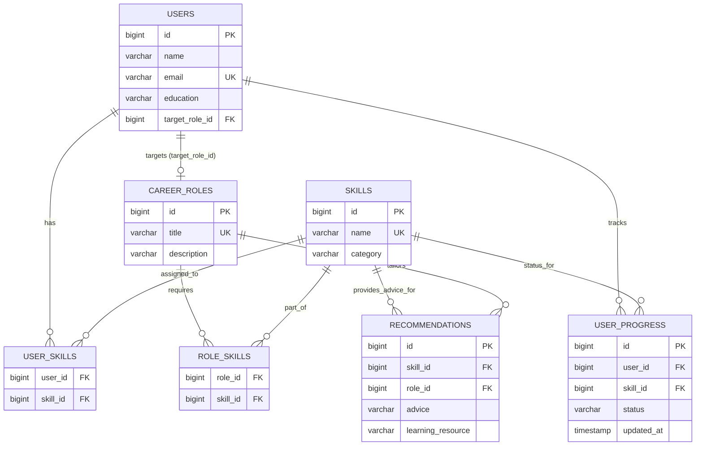

# One-Stop Career Advisor Platform

A clean, modular, and interview-friendly Java backend application built with **Java 17, Spring Boot 3, Spring Data JPA, and PostgreSQL**.

This platform allows users to maintain their professional skills and target career roles, perform transparent rule-driven skill gap analysis against role requirements, receive curated learning recommendations, and track their skill acquisition progress.

> [!NOTE]
> **Deterministic Rule-Based System (No AI/ML Bloat):**
> This application uses a transparent, explainable data matching algorithm based on set theory (set intersections and differences) rather than black-box AI models or external LLM APIs.

---

## Table of Contents
1. [Project Overview & Problem Statement](#project-overview--problem-statement)
2. [Key Features](#key-features)
3. [Technology Stack](#technology-stack)
4. [System Architecture](#system-architecture)
5. [Database Schema](#database-schema)
6. [Core Workflow & Skill-Matching Logic](#core-workflow--skill-matching-logic)
7. [REST API Documentation](#rest-api-documentation)
8. [Example API Requests & Responses](#example-api-requests--responses)
9. [Sample Data](#sample-data)
10. [Getting Started (Run Locally)](#getting-started-run-locally)
11. [Automated Testing](#automated-testing)
12. [Known Limitations](#known-limitations)
13. [Interview Explanation](#interview-explanation)

---

## Project Overview & Problem Statement

Aspiring software developers and students frequently struggle to identify the exact technical skill requirements for target roles (e.g., *Java Backend Developer*, *QA Automation Engineer*, *Software Engineer*, *Data Analyst*). Generic advice often lacks actionable roadmaps or personal progress tracking.

The **One-Stop Career Advisor Platform** solves this by providing:
- Structured user profile and skill catalog management.
- Predefined, database-driven career roles and skill requirements.
- A deterministic skill-matching engine that identifies exact skill gaps.
- Targeted learning recommendations for every missing skill.
- End-to-end progress tracking (`NOT_STARTED`, `IN_PROGRESS`, `COMPLETED`).

---

## Key Features

- **User Profile Management**: Full CRUD operations for candidate profiles, education details, and target career role selection.
- **Skill Catalog & Inventory**: Standardized catalog of technical skills with categories. Users can associate and remove skills from their profile.
- **Database-Driven Career Roles**: Roles and required skills are stored dynamically in relational database tables rather than hardcoded in application logic.
- **Transparent Skill-Gap Analysis**: Calculates matched skills, missing skills, and a transparent match percentage metric.
- **Targeted Learning Recommendations**: Returns actionable study topics and documentation links for missing skills.
- **Learning Progress Tracking**: Users can update progress on recommended skills (`NOT_STARTED`, `IN_PROGRESS`, `COMPLETED`). Marking a skill as `COMPLETED` automatically adds it to the user's acquired skill set.
- **Validation & Exception Handling**: Centralized `@RestControllerAdvice` providing structured JSON error responses with field-level validation diagnostics.

---

## Technology Stack

- **Language**: Java 17 (LTS)
- **Framework**: Spring Boot 3.3.4 (Spring Web, Spring Data JPA, Spring Validation)
- **Database**: PostgreSQL (Production/Dev), H2 Database (In-memory testing & Zero-config Dev profile)
- **ORM / Persistence**: Hibernate / JPA
- **Build Tool**: Apache Maven (with Maven Wrapper `mvnw`)
- **Testing**: JUnit 5, Mockito, Spring Boot Test (`MockMvc`, `@WebMvcTest`, `@SpringBootTest`)

---

## System Architecture

The application follows a standard **3-Tier Layered Architecture** with strict separation of concerns:

```
[ HTTP Client (Postman / Browser / Frontend) ]
                       │
                       ▼
             [ Controller Layer ]         <── Validates DTO inputs, handles HTTP routing
                       │
                       ▼
              [ Service Layer ]           <── Encapsulates business logic & skill-matching engine
                       │
                       ▼
             [ Repository Layer ]         <── Spring Data JPA data access interfaces
                       │
                       ▼
        [ PostgreSQL / H2 Database ]      <── Normalized relational schema
```

### Package Structure
```
src/main/java/com/example/careeradvisor/
├── CareerAdvisorApplication.java     # Spring Boot application entrypoint
├── config/
│   └── DataInitializer.java          # Seeds 14 skills, 4 roles & recommendations
├── controller/
│   ├── CareerAdviceController.java   # /api/career-advice/{userId}
│   ├── CareerRoleController.java     # /api/roles
│   ├── SkillController.java          # /api/skills
│   ├── UserController.java           # /api/users & /api/users/{id}/skills
│   └── UserProgressController.java   # /api/users/{id}/progress
├── dto/
│   ├── AddUserSkillRequest.java      # DTO for adding skill to user
│   ├── CareerAdviceResponse.java     # Structured matching output DTO
│   ├── CareerRoleResponse.java       # Career role response DTO
│   ├── CareerRoleSummaryDto.java     # Lightweight role summary DTO
│   ├── ErrorResponse.java            # Standard error envelope DTO
│   ├── MissingSkillAdviceDto.java    # Missing skill with advice & progress status
│   ├── ProgressUpdateRequest.java    # Progress status update DTO
│   ├── SkillRequest.java             # Skill creation request DTO
│   ├── SkillResponse.java            # Skill response DTO
│   ├── UserProgressResponse.java     # Progress response DTO
│   ├── UserRequest.java              # User creation/update DTO
│   └── UserResponse.java             # User response DTO
├── entity/
│   ├── CareerRole.java               # CareerRole JPA entity
│   ├── ProgressStatus.java           # Enum (NOT_STARTED, IN_PROGRESS, COMPLETED)
│   ├── Recommendation.java           # Recommendation JPA entity
│   ├── Skill.java                    # Skill JPA entity
│   ├── User.java                     # User JPA entity
│   └── UserProgress.java             # UserProgress JPA entity with unique constraint
├── exception/
│   ├── BadRequestException.java      # 400 Bad Request
│   ├── DuplicateResourceException.java# 409 Conflict
│   ├── GlobalExceptionHandler.java   # Centralized @RestControllerAdvice
│   └── ResourceNotFoundException.java# 404 Not Found
└── repository/
    ├── CareerRoleRepository.java     # Role repository with custom fetch joins
    ├── RecommendationRepository.java # Recommendation query repository
    ├── SkillRepository.java          # Skill catalog repository
    ├── UserProgressRepository.java   # User progress repository
    └── UserRepository.java           # User repository with fetch joins
```

---

## Database Schema



---

## Core Workflow & Skill-Matching Logic

The skill-matching engine (`CareerAdviceService.java`) executes a deterministic set comparison:

```
User Skills (U)                    Required Role Skills (R)
   [ Java, SQL, Git ]                 [ Java, SQL, Spring Boot, REST API, Git, JUnit ]
               \                                   /
                \                                 /
                 ▼                               ▼
       Matched Skills (M = U ∩ R)         Missing Skills / Gaps (G = R \ U)
           [ Java, SQL, Git ]                 [ Spring Boot, REST API, JUnit ]
                   │                                      │
                   ▼                                      ▼
     Match Percentage: (3 / 6) * 100 = 50.0%    Fetch Recommendations & Track Progress
```

### Mathematical Formula:
$$\text{Match Percentage} = \left( \frac{|\text{User Skills} \cap \text{Required Skills}|}{|\text{Required Skills}|} \right) \times 100$$

### Transparency Disclaimer:
The platform includes an explicit note in the response payload:
> *"This skill comparison is a deterministic rule-based evaluation against the predefined requirements for [Role]. It serves as a personal learning guide and is not an objective assessment of total employability."*

---

## REST API Documentation

### 1. User Profile Management (`/api/users`)
| Method | Endpoint | Description | Status Codes |
|---|---|---|---|
| `POST` | `/api/users` | Create user profile with optional target role | `201`, `400`, `409` |
| `GET` | `/api/users` | Retrieve all user profiles | `200` |
| `GET` | `/api/users/{id}` | Retrieve single user profile by ID | `200`, `404` |
| `PUT` | `/api/users/{id}` | Update profile details or target role | `200`, `400`, `404`, `409` |
| `DELETE` | `/api/users/{id}` | Delete user profile and associated progress | `204`, `404` |

### 2. User Skills Management (`/api/users/{id}/skills`)
| Method | Endpoint | Description | Status Codes |
|---|---|---|---|
| `GET` | `/api/users/{id}/skills` | Retrieve all skills possessed by user | `200`, `404` |
| `POST` | `/api/users/{id}/skills` | Add an existing skill to user profile | `200`, `400`, `404`, `409` |
| `DELETE` | `/api/users/{id}/skills/{skillId}` | Remove a skill from user profile | `200`, `404` |

### 3. Skill Catalog (`/api/skills`)
| Method | Endpoint | Description | Status Codes |
|---|---|---|---|
| `GET` | `/api/skills` | Retrieve all skills in catalog | `200` |
| `GET` | `/api/skills/{id}` | Retrieve skill by ID | `200`, `404` |
| `POST` | `/api/skills` | Add new skill to catalog | `201`, `400`, `409` |
| `DELETE` | `/api/skills/{id}` | Delete skill from catalog | `204`, `404` |

### 4. Career Roles (`/api/roles`)
| Method | Endpoint | Description | Status Codes |
|---|---|---|---|
| `GET` | `/api/roles` | Retrieve all career roles and required skills | `200` |
| `GET` | `/api/roles/{id}` | Retrieve career role by ID | `200`, `404` |

### 5. Career Advice & Skill Matching (`/api/career-advice`)
| Method | Endpoint | Description | Status Codes |
|---|---|---|---|
| `GET` | `/api/career-advice/{userId}` | Generate rule-based skill comparison and recommendations | `200`, `400`, `404` |

### 6. Progress Tracking (`/api/users/{id}/progress`)
| Method | Endpoint | Description | Status Codes |
|---|---|---|---|
| `GET` | `/api/users/{id}/progress` | Retrieve user's skill learning progress | `200`, `404` |
| `PUT` | `/api/users/{id}/progress/{skillId}` | Update progress (`NOT_STARTED`, `IN_PROGRESS`, `COMPLETED`) | `200`, `400`, `404` |

---

## Example API Requests & Responses

### 1. Create User Profile
```bash
curl -X POST http://localhost:8080/api/users \
  -H "Content-Type: application/json" \
  -d '{
    "name": "Harshavardhan Varma",
    "email": "harsha@example.com",
    "education": "B.Tech Computer Science",
    "targetRoleId": 1
  }'
```

*Response (201 Created):*
```json
{
  "id": 1,
  "name": "Harshavardhan Varma",
  "email": "harsha@example.com",
  "education": "B.Tech Computer Science",
  "targetRole": {
    "id": 1,
    "title": "Java Backend Developer"
  },
  "skills": []
}
```

### 2. Add Skills to User
```bash
curl -X POST http://localhost:8080/api/users/1/skills \
  -H "Content-Type: application/json" \
  -d '{ "skillId": 1 }'
```

### 3. Generate Career Advice
```bash
curl -X GET http://localhost:8080/api/career-advice/1
```

*Response (200 OK):*
```json
{
  "userId": 1,
  "userName": "Harshavardhan Varma",
  "targetRole": "Java Backend Developer",
  "totalRequiredSkills": 6,
  "matchedSkillsCount": 2,
  "missingSkillsCount": 4,
  "matchPercentage": 33.3,
  "matchedSkills": [
    {
      "id": 1,
      "name": "Java",
      "category": "Programming Language"
    },
    {
      "id": 3,
      "name": "SQL",
      "category": "Database"
    }
  ],
  "skillGaps": [
    {
      "skillId": 8,
      "skillName": "Git",
      "category": "Tools & Version Control",
      "recommendation": "Practice basic version control workflows: git init, clone, add, commit, push, pull, branch, merge, and handling merge conflicts.",
      "learningResource": "Pro Git Book (https://git-scm.com/book) & GitHub Skills interactive guides.",
      "currentStatus": "NOT_STARTED"
    },
    {
      "skillId": 10,
      "skillName": "JUnit/Testing",
      "category": "Testing & QA",
      "recommendation": "Learn unit testing with JUnit 5 annotations (@Test, @BeforeEach), assertions (assertEquals, assertThrows), and mocking dependencies with Mockito.",
      "learningResource": "JUnit 5 User Guide & Baeldung Mockito Guide.",
      "currentStatus": "NOT_STARTED"
    },
    {
      "skillId": 6,
      "skillName": "REST API",
      "category": "Architecture & Web",
      "recommendation": "Study HTTP methods (GET, POST, PUT, DELETE), status codes (200, 201, 400, 404, 500), JSON request/response formats, and API versioning.",
      "learningResource": "RESTful API Design Best Practices & Mozilla MDN Web Docs.",
      "currentStatus": "NOT_STARTED"
    },
    {
      "skillId": 5,
      "skillName": "Spring Boot",
      "category": "Framework",
      "recommendation": "Learn Spring Boot fundamentals, dependency injection (@Autowired, @Component), Spring Data JPA, and build a 3-tier REST API.",
      "learningResource": "Spring Guides (https://spring.io/guides) and Baeldung Spring tutorials.",
      "currentStatus": "IN_PROGRESS"
    }
  ],
  "note": "This skill comparison is a deterministic rule-based evaluation against the predefined requirements for Java Backend Developer. It serves as a personal learning guide and is not an objective assessment of total employability."
}
```

### 4. Update Skill Progress
```bash
curl -X PUT http://localhost:8080/api/users/1/progress/5 \
  -H "Content-Type: application/json" \
  -d '{ "status": "COMPLETED" }'
```

*Response (200 OK):*
```json
{
  "id": 1,
  "userId": 1,
  "skill": {
    "id": 5,
    "name": "Spring Boot",
    "category": "Framework"
  },
  "status": "COMPLETED",
  "updatedAt": "2026-10-03T14:40:00.000"
}
```

---

## Sample Data

On first startup, `DataInitializer.java` automatically seeds:

### 4 Career Roles:
1. **Java Backend Developer**: Java, SQL, Spring Boot, REST API, Git, JUnit/Testing
2. **Software Engineer**: Java, Data Structures, SQL, REST API, Git, Linux Basics
3. **QA Automation Engineer**: Java, SQL, JUnit/Testing, REST API, Git
4. **Data Analyst**: SQL, Python, PostgreSQL, Git

### 14 Skills:
Java, Python, SQL, PostgreSQL, Spring Boot, REST API, Data Structures, Git, Docker, JUnit/Testing, HTML/CSS, Linux Basics, Microservices Concepts, CI/CD Fundamentals.

---

## Getting Started (Run Locally)

### Prerequisites
- **Java 17+**
- **PostgreSQL** (or run with embedded H2 profile)

### Option A: Running with PostgreSQL

1. **Create Database in PostgreSQL**:
   ```sql
   CREATE DATABASE career_advisor_db;
   ```

2. **Configure Database Credentials**:
   Either set environment variables or edit `src/main/resources/application.properties`:
   ```properties
   spring.datasource.url=jdbc:postgresql://localhost:5432/career_advisor_db
   spring.datasource.username=postgres
   spring.datasource.password=your_password
   ```

3. **Run using Maven Wrapper**:
   ```bash
   # Windows
   .\mvnw.cmd spring-boot:run

   # Linux / macOS
   ./mvnw spring-boot:run
   ```

### Option B: Running with In-Memory H2 (Zero-Config Mode)

To run immediately without installing PostgreSQL:
```bash
# Windows
.\mvnw.cmd spring-boot:run -Dspring-boot.run.profiles=h2

# Linux / macOS
./mvnw spring-boot:run -Dspring-boot.run.profiles=h2
```
Access H2 Web Console at: `http://localhost:8080/h2-console` (JDBC URL: `jdbc:h2:mem:career_advisor_dev`).

---

## Automated Testing

Run the full suite of **35 automated tests** (unit tests with Mockito and integration tests with MockMvc):

```bash
# Windows
.\mvnw.cmd test

# Linux / macOS
./mvnw test
```

### Test Breakdown:
- **`CareerAdviceServiceTest`**: Tests partial matches, 100% full matches, 0% matches, missing role validation, and resource not found exceptions.
- **`UserServiceTest`**: Tests profile creation, duplicate email rejection, adding skills, duplicate skill detection, and removal.
- **`UserProgressServiceTest`**: Tests status transitions and automatic skill acquisition upon completion.
- **`SkillServiceTest` & `CareerRoleServiceTest`**: Tests catalog CRUD and uniqueness constraints.
- **`UserControllerTest`, `CareerAdviceControllerTest`, `SkillControllerTest`, `CareerRoleControllerTest`, `UserProgressControllerTest`**: WebMvc HTTP tests validating status codes (`200`, `201`, `400`, `404`, `409`) and JSON schemas.
- **`CareerAdvisorIntegrationTest`**: End-to-end integration test verifying the complete user journey from creation to advice generation and progress tracking.

---

## Known Limitations

1. **Single Role Target**: Currently, a user selects one primary target career role at a time.
2. **Binary Skill Matching**: Matches skills based on discrete presence rather than tiered proficiency levels (e.g., Beginner/Intermediate/Expert).
3. **Synchronous REST API**: Advice generation executes synchronously upon request. For very large skill graphs, caching or background precomputations could be added.

---

## Interview Explanation

Here is a quick-reference guide explaining the key engineering decisions for technical interviews:

### 1. Why Spring Boot & Spring Data JPA?
Spring Boot provides industry-standard dependency injection, clean modular configuration, and embedded servlet container support. Spring Data JPA drastically reduces boilerplate data access code while providing type-safe repositories, transaction management (`@Transactional`), and optimized JPQL fetch joins to eliminate the classic $N+1$ query problem.

### 2. Why a Rule-Based Engine instead of AI/ML?
Career skill matching requires predictable, verifiable, and explainable results. Using relational set theory ($U \cap R$ and $R \setminus U$) ensures:
- 100% deterministic accuracy with zero hallucination.
- Instant computation with minimal latency.
- Full transparency for candidates regarding why specific recommendations are given.

### 3. Database Relationships Design
- **`users` $\leftrightarrow$ `skills`**: Many-to-Many via `user_skills` join table.
- **`career_roles` $\leftrightarrow$ `skills`**: Many-to-Many via `role_skills` join table.
- **`users` $\rightarrow$ `career_roles`**: Many-to-One (`target_role_id`).
- **`user_progress`**: Unique constraint on `(user_id, skill_id)` ensuring a candidate cannot have conflicting status records for the same skill.

### 4. REST API & Validation Strategy
- DTOs encapsulate request/response contracts, isolating database entities from API consumers.
- Jakarta Validation annotations (`@NotBlank`, `@Email`, `@NotNull`, `@Size`) enforce data hygiene at the controller boundary.
- `@RestControllerAdvice` translates domain exceptions (`ResourceNotFoundException`, `DuplicateResourceException`, `BadRequestException`) into consistent RFC 7807-style JSON error payloads with proper HTTP status codes (`400`, `404`, `409`, `500`).

### 5. How this can be evolved for large-scale production
1. **Proficiency Ratings**: Add a rating scale (1–5) or years of experience weighting to skills.
2. **Course / Resource Integration**: Connect with external LMS or verified course catalog tables.
3. **Authentication & Multi-Tenancy**: Add Spring Security with JWT/OAuth2 for multi-user authentication.
4. **Caching**: Utilize Spring Cache with Redis for frequently accessed skill catalogs and role requirements.

---

## License
MIT License. Developed as a realistic portfolio and interview demonstration project.
